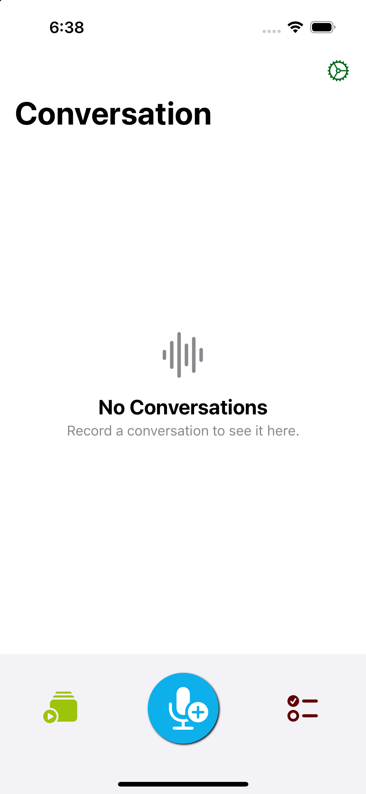
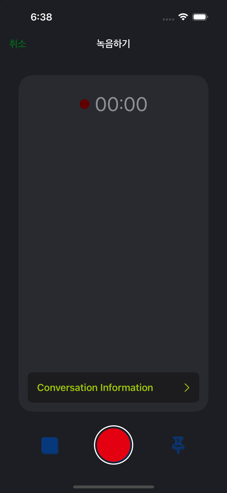
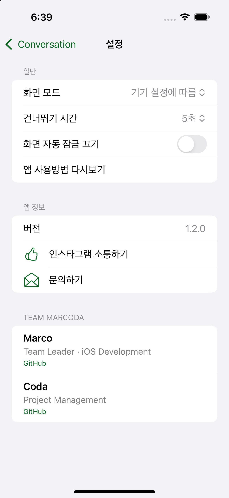

# CasualConversation

영어 회화를 녹음하고 다시 들으면서 놓친 단어와 문장을 기록하는 iOS 앱입니다.

<p>
  <a href="https://apps.apple.com/kr/app/casualconversation/id1642134370"></a>
  
  
  
</p>

## 앱 소개

짧은 영어 회화 중 바로 이해하지 못했거나 표현하지 못한 부분을 나중에 다시 학습할 수 있도록 돕습니다.

- 대화를 녹음하고 중요한 순간에 핀 표시
- 제목, 주제, 참여자와 함께 녹음 저장
- 녹음 재생, 구간 이동, 0.5배속부터 2배속까지 속도 조절
- 대화에 연결된 단어와 문장 기록
- 화면 모드, 건너뛰기 시간, 자동 잠금 설정
- v1 CoreData 데이터와 녹음 파일을 v2 SwiftData 구조로 자동 이전

[App Store](https://apps.apple.com/kr/app/casualconversation/id1642134370) · [Instagram](https://www.instagram.com/casualconversation_ccrecorder/)

## v2 화면

<p align="center">
  
  
  
</p>

## 저장소 구성

Tuist로 생성하는 v2 앱과 데이터 마이그레이션 참고용 v1 코드가 한 저장소에 공존합니다.

```text
Project/App/
├── App/                 # v2 앱 소스와 리소스
├── Presentation/        # SwiftUI와 TCA 화면 레이어
├── Domain/              # Entity, Usecase, Repository 계약
├── Data/                # Repository와 영속성 구현
├── Tests/               # 테스트 플랜과 Unit/UI 테스트
└── Project.swift        # Tuist 프로젝트 정의

CasualConversation/      # v1 레거시 — 마이그레이션 참고용
Docs/                    # 개발 문서와 v2 이미지
```

새 기능과 수정은 `Project/App/`의 v2 앱을 대상으로 합니다. `CasualConversation/`은 출시된 v1 데이터 구조를 확인하기 위한 레거시 코드이며 신규 개발 대상이 아닙니다.

## 기술 구성

- SwiftUI
- SwiftData
- Observation
- AVFAudio (`AVAudioRecorder`, `AVAudioPlayer`, `AVAudioSession`)
- Core Data 기반 v1 저장소 마이그레이션
- Swift Testing, XCTest
- Xcode Cloud

v2는 Tuist workspace에서 App, Presentation, Domain, Data 레이어를 구성합니다. Presentation은 SwiftUI와 TCA 화면을, Domain은 Entity와 Usecase 및 Repository 계약을, Data는 Repository 구현과 영속성 기술을 담당합니다.

## 실행 방법

### 요구 사항

- Xcode 26.2 이상
- Tuist 4.203.1 이상
- iOS 18.0 이상
- 녹음 기능을 실행할 기기의 마이크 권한

### Xcode

1. 저장소 루트에서 `tuist generate`를 실행합니다.
2. 생성된 `CCRecorder.xcworkspace`를 엽니다.
3. `App` 스킴을 선택합니다.
4. iOS 18.0 이상의 Simulator 또는 실기기를 선택합니다.
5. 서명이 필요한 실기기 빌드는 프로젝트의 Development Team을 설정합니다.
6. 앱을 실행합니다.

명령행에서 Simulator 빌드만 확인하려면 다음을 실행합니다.

```sh
xcodebuild build \
  -workspace CCRecorder.xcworkspace \
  -scheme App \
  -configuration Debug \
  -destination 'generic/platform=iOS Simulator' \
  CODE_SIGNING_ALLOWED=NO
```

Xcode Cloud에서는 post-clone 단계에 Tuist 4.203.1을 설치하고 Git에서 제외된 `CCRecorder.xcworkspace`를 생성한 뒤 `App` 스킴을 빌드합니다.

## 테스트

Xcode Cloud에서는 `CI-Unit`, 로컬 UI 테스트에서는 `Local-UI` 플랜을 사용합니다.

```sh
# 앱 유닛 테스트
xcodebuild test \
  -workspace CCRecorder.xcworkspace \
  -scheme App \
  -testPlan CI-Unit \
  -destination 'platform=iOS Simulator,name=iPhone 15 Pro,OS=18.0'

# UI 테스트
xcodebuild test \
  -workspace CCRecorder.xcworkspace \
  -scheme App \
  -testPlan Local-UI \
  -destination 'platform=iOS Simulator,name=iPhone 15 Pro,OS=18.0'

```

실제 마이크 입력이 필요한 테스트와 CI 운영 기준은 [테스트 운영 문서](Docs/Testing.md)를 참고하세요.

## v1 데이터 마이그레이션

v2는 App Store의 v1과 동일한 Bundle ID(`com.pseapplications.CasualConversation`)를 유지합니다. 첫 실행 시 기존 CoreData 저장소가 발견되면 다음 데이터를 SwiftData와 v2 녹음 디렉터리로 옮깁니다.

- 대화, 참여자, 핀
- 단어·문장 노트와 대화 연결
- `Documents/Records`의 녹음 파일

마이그레이션 도중 실패하면 v1 원본을 삭제하지 않으며, 완료 플래그가 기록되기 전까지 다음 실행에서 다시 시도할 수 있습니다.

## 배포 상태

| 버전 | 상태 | 주요 내용 |
| --- | --- | --- |
| 1.1.0 | App Store 배포 중 | 튜토리얼과 녹음 재생 안정화 |
| 1.2.0 | v2 출시 준비 | SwiftUI·SwiftData 기반 재구성, v1 데이터 마이그레이션, 녹음·재생·노트·설정 개선 |

### 1.2.0 릴리즈 노트 초안

- 앱의 화면과 데이터 구조를 새롭게 구성했습니다.
- 기존 대화, 노트, 녹음 파일을 안전하게 이전합니다.
- 녹음과 재생 제어를 개선하고 재생 속도 및 건너뛰기 설정을 추가했습니다.
- 빈 목록 안내와 오류 처리를 개선했습니다.

## 팀

- [Marco](https://github.com/Marcorable) — Team Leader · iOS Development
- [Coda](https://github.com/dacodaco) — Project Management
